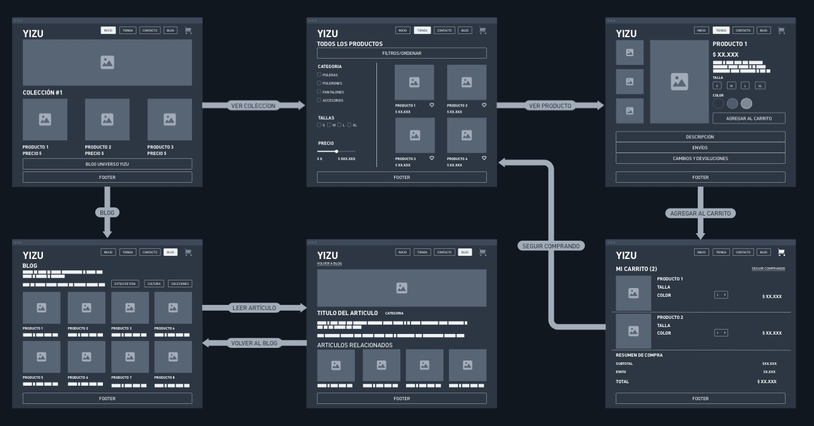

# Spec de diseño — YIZU

> Guía: [Spec de diseño](../evaluacion/guias/fase-2-specs/06-spec-de-diseno.md)

La spec de diseño tiene dos partes:

1. **[`DESIGN.md`](../DESIGN.md)** (en la raíz): tu design system, en el formato que Stitch importa.
2. **Este documento:** tus pantallas, escritas como prompts listos para pegar en Stitch.

**Wireframes en Whimsical:** https://whimsical.com/tomy-s3/yizu-zmn9vjwFdWNS2guEyx9C6

> Guía de wireframes: [Wireframes](../evaluacion/guias/fase-2-specs/04-wireframes.md)



## Pantallas

<!-- Un prompt por pantalla. Cada uno con: pantalla y dispositivo, objetivo
de tu proto-persona, componentes de arriba hacia abajo (con los nombres de
tu DESIGN.md) y textos y datos reales. -->
## Pantallas

### 1. Landing

**Pantalla:** Landing de YIZU, versión desktop.

**Objetivo:** Presentar la identidad de YIZU, destacar su primera colección e incentivar la exploración de productos y contenido editorial.

**Prompt para Google Stitch:**

```text

Diseña la landing page desktop de YIZU, una marca de ropa urbana y streetwear contemporáneo.

Utiliza el design system del proyecto DESIGN.md.

Estética minimalista, urbana y experimental, con predominio de negro carbón #121212, fondo Lighthouse #F4F4F2, gris metálico #989A97 y detalles verde agreste #50584B.

Utiliza Bebas Neue en títulos principales y Press Start 2P en pequeños elementos destacados.

Respeta el wireframe de Whimsical.

Componentes de arriba hacia abajo:

1. Navbar:

   - Logotipo YIZU a la izquierda.

   - Menú Inicio, Tienda, Contacto y Blog.

   - Icono de carrito a la derecha.

   - Inicio seleccionado.

2. Hero principal:

   - Imagen horizontal grande de moda urbana.

   - Fotografía editorial de prendas YIZU.

   - Mensaje principal: "YIZU - VISTE TU IDENTIDAD".

   - Botón button-primary: "EXPLORAR COLECCIÓN".

3. Colección destacada:

   - Título: "COLECCIÓN #1".

   - Tres tarjetas card-product en una fila.

   - Cada tarjeta contiene fotografía, nombre y precio visible.

   - Productos de ejemplo:

     "Polera YIZU Essential".

     "Polerón YIZU Oversize".

     "Pantalón YIZU Street".

   - Utilizar precios referenciales en CLP, claramente identificados como ejemplos.

4. Acceso al blog:

   - Bloque horizontal.

   - Texto: "BLOG UNIVERSO YIZU".

   - Enlace a publicaciones editoriales.

5. Footer:

   - Marca YIZU.

   - Enlaces Inicio, Tienda, Contacto y Blog.

   - Información de contacto y redes sociales.

Usa imágenes de moda urbana, espacios limpios, jerarquía tipográfica marcada y botones redondeados.

Mantén el orden y estructura del wireframe original.

```

### 2. Tienda

**Pantalla:** Tienda de YIZU, versión desktop.

**Objetivo:** Permitir que los usuarios exploren el catálogo de ropa, filtren productos y accedan a sus fichas individuales.

**Prompt para Google Stitch:**

```text

Diseña la tienda online desktop de YIZU.

Utiliza el archivo DESIGN.md y conserva la identidad urbana, minimalista y experimental.

Respeta el wireframe de Whimsical.

Componentes de arriba hacia abajo:

1. Navbar:

   - Logotipo YIZU.

   - Inicio, Tienda, Contacto y Blog.

   - Icono del carrito.

   - Tienda seleccionada.

2. Encabezado:

   - Título "TODOS LOS PRODUCTOS".

   - Tipografía Bebas Neue.

3. Barra de filtros:

   - Contenedor horizontal.

   - Texto "FILTROS / ORDENAR".

   - Opciones de ordenamiento por precio y novedades.

4. Layout principal:

   - Sidebar izquierda de filtros.

   - Catálogo de productos a la derecha.

5. Sidebar:

   - Categorías con checkbox:

     Poleras.

     Polerones.

     Pantalones.

     Accesorios.

   - Tallas:

     S, M, L y XL.

   - Filtro de precio mediante slider.

6. Catálogo:

   - Cuatro tarjetas card-product.

   - Distribución de dos columnas y dos filas, siguiendo el wireframe.

   - Fotografía de cada prenda.

   - Nombre del producto.

   - Precio en CLP.

   - Icono de favoritos.

   - Enlace a ficha individual.

7. Footer:

   - Navegación secundaria.

   - Información de marca y contacto.

Los productos deben tener imágenes grandes, fondos neutros y nombres visibles.

El precio siempre debe ser visible.

Aplicar estados normal, hover y active en filtros y tarjetas.

Mantener el diseño geométrico y los espaciados del sistema.

```

### 3. Ficha de producto

**Pantalla:** Ficha de producto de YIZU, versión desktop.

**Objetivo:** Entregar información sobre una prenda y permitir seleccionar sus variantes antes de agregarla al carrito.

**Prompt para Google Stitch:**

```text

Diseña una ficha de producto desktop para YIZU.

Utiliza DESIGN.md y respeta el wireframe original.

La página debe tener una apariencia moderna, limpia y orientada a la compra.

Componentes de arriba hacia abajo:

1. Navbar:

   - Logotipo YIZU.

   - Inicio, Tienda, Contacto y Blog.

   - Icono de carrito.

   - Tienda seleccionada.

2. Galería de producto:

   - Tres miniaturas verticales a la izquierda.

   - Una imagen principal grande al centro.

   - Fotografías de una prenda urbana YIZU.

   - Imágenes con esquinas rectas.

3. Información del producto:

   - Ubicada a la derecha.

   - Nombre: "POLERA YIZU ESSENTIAL".

   - Precio referencial en CLP.

   - Descripción breve de la prenda.

4. Selector de talla:

   - Título "TALLA".

   - Opciones S, M, L y XL.

   - Mostrar estado active de la talla seleccionada.

5. Selector de color:

   - Título "COLOR".

   - Tres muestras circulares.

   - Negro carbón.

   - Gris metálico.

   - Blanco.

   - Mostrar claramente el color seleccionado.

6. Botón principal:

   - Componente button-primary.

   - Texto "AGREGAR AL CARRITO".

   - Fondo negro carbón.

   - Texto blanco.

   - Hover gris antracita.

   - Estado disabled cuando no se selecciona talla.

7. Información adicional:
   - Sección "3 ARTICULOS". 

   - Sección desplegable "DESCRIPCIÓN".

   - Sección desplegable "ENVÍOS".

   - Sección desplegable "CAMBIOS Y DEVOLUCIONES".

8. Footer:

   - Información de YIZU.

   - Enlaces de navegación y contacto.

Mantener una jerarquía visual donde la fotografía, el nombre, el precio y el botón de compra sean los elementos principales.

Utilizar card-product, button-primary y componentes de selección consistentes con DESIGN.md.

```

### 4. Carrito

**Pantalla:** Carrito de compras de YIZU, versión desktop.

**Objetivo:** Permitir revisar los productos seleccionados, modificar cantidades y consultar el resumen de compra.

**Prompt para Google Stitch:**

```text

Diseña el carrito de compras desktop de YIZU.

Aplica el design system DESIGN.md y conserva el estilo visual de las demás pantallas.

Respeta el wireframe de Whimsical.

Componentes de arriba hacia abajo:

1. Navbar:

   - Logotipo YIZU.

   - Inicio, Tienda, Contacto y Blog.

   - Icono del carrito con indicador de productos.

2. Encabezado:

   - Título "MI CARRITO (2)".

   - Enlace "SEGUIR COMPRANDO" alineado a la derecha.

3. Primer producto:

   - Fotografía a la izquierda.

   - Nombre "POLERA YIZU ESSENTIAL".

   - Talla seleccionada.

   - Color seleccionado.

   - Selector de cantidad con valor inicial 1.

   - Precio referencial en CLP.

   - Opción para eliminar producto.

4. Segundo producto:

   - Fotografía a la izquierda.

   - Nombre "POLERÓN YIZU OVERSIZE".

   - Talla seleccionada.

   - Color seleccionado.

   - Selector de cantidad con valor inicial 1.

   - Precio referencial en CLP.

   - Opción para eliminar producto.

5. Separadores:

   - Líneas horizontales finas entre productos.

   - Color gris metálico.

6. Resumen de compra:

   - Título "RESUMEN DE COMPRA".

   - Subtotal.

   - Envío.

   - Total destacado.

   - Montos referenciales coherentes con los productos.

   - Botón button-primary "CONTINUAR COMPRA".

7. Footer:

   - Marca YIZU.

   - Enlaces y contacto.

El total debe actualizarse visualmente según las cantidades.

Usar una composición ordenada, imágenes claras y controles accesibles.

El precio y el total siempre deben ser visibles.

Considerar estados normal, active y disabled de los controles.

```

### 5. Blog

**Pantalla:** Blog de YIZU, versión desktop.

**Objetivo:** Presentar contenido editorial relacionado con moda urbana, estilo de vida, cultura y colecciones de YIZU.

**Prompt para Google Stitch:**

```text

Diseña la página de blog desktop de YIZU.

Aplica DESIGN.md y respeta el wireframe realizado en Whimsical.

El diseño debe combinar estética streetwear y composición editorial contemporánea.

Componentes de arriba hacia abajo:

1. Navbar:

   - Logotipo YIZU.

   - Inicio, Tienda, Contacto y Blog.

   - Icono de carrito.

   - Blog seleccionado.

2. Encabezado:

   - Título "BLOG".

   - Introducción:

     "Explora el universo YIZU: moda urbana, cultura e identidad".

   - Texto secundario:

     "Ideas, inspiración y nuevas perspectivas del streetwear".

3. Categorías:

   - Botón "ESTILO DE VIDA".

   - Botón "CULTURA".

   - Botón "COLECCIONES".

   - Mostrar estado active al seleccionar categoría.

4. Cuadrícula editorial:

   - Ocho tarjetas de artículos.

   - Cuatro columnas y dos filas.

   - Fotografía editorial en cada tarjeta.

   - Título breve de cada publicación.

   - Categoría de contenido.

   - Enlace para leer el artículo.

5. Artículos de ejemplo:

   - "El streetwear como identidad".

   - "Cómo construir tu estilo urbano".

   - "La cultura detrás de YIZU".

   - "Minimalismo en la moda actual".

   - "Prendas esenciales del streetwear".

   - "El futuro de la moda urbana".

   - "Diseño y expresión personal".

   - "Universo YIZU: primera colección".

6. Footer:

   - Identidad YIZU.

   - Navegación y contacto.

Utilizar card-product como base visual de las tarjetas editoriales, adaptando su contenido a artículos.

Mantener imágenes rectangulares, espacios amplios y títulos de alto impacto.

No mostrar precios porque se trata de contenido editorial.

```

### 6. Artículo

**Pantalla:** Artículo del blog de YIZU, versión desktop.

**Objetivo:** Permitir leer una publicación completa y descubrir otros artículos relacionados con la cultura e identidad de YIZU.

**Prompt para Google Stitch:**

```text

Diseña la página de artículo del blog de YIZU en versión desktop.

Utiliza DESIGN.md y respeta el wireframe original de Whimsical.

La composición debe ser editorial, minimalista y enfocada en la lectura.

Componentes de arriba hacia abajo:

1. Navbar:

   - Logotipo YIZU.

   - Inicio, Tienda, Contacto y Blog.

   - Icono de carrito.

   - Blog seleccionado.

2. Navegación secundaria:

   - Enlace "VOLVER A BLOG".

3. Imagen principal:

   - Fotografía horizontal grande.

   - Imagen editorial relacionada con moda urbana y streetwear.

4. Encabezado del artículo:

   - Título "EL STREETWEAR COMO IDENTIDAD".

   - Categoría "CULTURA".

   - Tipografía Bebas Neue.

5. Contenido del artículo:

   - Texto introductorio:

     "La moda urbana es mucho más que una tendencia. Es una forma de expresar identidad, creatividad y pertenencia a una cultura en constante evolución".

   - Segundo párrafo:

     "En YIZU entendemos el streetwear como un lenguaje visual que conecta diseño, música, arte y estilo personal. Cada prenda representa una oportunidad para construir una identidad propia".

   - Tercer párrafo:

     "Nuestra propuesta combina elementos minimalistas, referencias contemporáneas y una estética experimental para crear prendas que acompañen diferentes formas de expresión".

6. Artículos relacionados:

   - Título "ARTÍCULOS RELACIONADOS".

   - Cuatro tarjetas editoriales horizontales.

   - Cada tarjeta incluye imagen y título.

   - Publicaciones:

     "Cómo construir tu estilo urbano".

     "Minimalismo en la moda actual".

     "La cultura detrás de YIZU".

     "Diseño y expresión personal".

7. Footer:

   - Marca YIZU.

   - Navegación y contacto.

Utilizar texto de alta legibilidad, párrafos con interlineado cómodo y márgenes amplios.

La imagen principal debe destacar visualmente sin competir con el título.

Mantener coherencia con la página de Blog y los componentes del design system.

```

---

## Versión mobile (para cada pantalla)

**Objetivo:** Adaptar las seis pantallas de YIZU a dispositivos móviles, manteniendo sus funciones y la identidad visual.

**Prompt general para Google Stitch:**

```text

Genera la versión mobile de cada una de las seis pantallas de YIZU utilizando un ancho de 375px.

Usa el mismo archivo DESIGN.md y conserva los colores, tipografías, componentes y jerarquía visual de las versiones desktop.

Aplica el diseño responsive definido en la sección Layout.

Reglas generales:

1. Sustituir la navegación horizontal por un menú hamburguesa.

2. Mantener el logotipo YIZU visible.

3. Mantener el acceso al carrito.

4. Organizar los contenidos en columnas adaptadas a 375px.

5. Conservar los botones principales accesibles.

6. Utilizar títulos responsive:

   h1 40px.

   h2 32px.

   h3 26px.

7. Usar párrafos de 12px según la escala documentada.

8. Mantener los contrastes del sistema.

9. Evitar desplazamiento horizontal.

10. Respetar la jerarquía y los recorridos de usuario definidos en Whimsical.

Adaptaciones por pantalla:

LANDING:

- Hero adaptado al ancho móvil.

- Colección destacada en una columna.

- Tres productos organizados verticalmente.

- Acceso al blog debajo de la colección.

- Footer compacto.

TIENDA:

- Filtros dentro de un panel desplegable.

- Categorías, tallas y precio accesibles.

- Catálogo de dos columnas cuando exista espacio suficiente.

- Tarjetas de producto compactas.

- Precios siempre visibles.

FICHA DE PRODUCTO:

- Galería principal arriba.

- Miniaturas debajo de la imagen.

- Nombre y precio.

- Selectores de talla y color.

- Botón AGREGAR AL CARRITO de ancho completo.

- Descripción, envíos y devoluciones desplegables.

CARRITO:

- Productos organizados verticalmente.

- Imagen, nombre, talla y color.

- Selector de cantidad accesible.

- Resumen de compra debajo de los productos.

- Total y botón CONTINUAR COMPRA destacados.

BLOG:

- Introducción breve.

- Categorías desplazables horizontalmente.

- Tarjetas editoriales en una columna.

- Imágenes adaptadas al ancho móvil.

- Footer compacto.

ARTÍCULO:

- Imagen principal adaptada.

- Título y categoría debajo.

- Texto en una columna.

- Márgenes de lectura cómodos.

- Artículos relacionados en una columna.

- Enlace VOLVER A BLOG visible.

Todas las versiones deben mantener la identidad visual YIZU y respetar la estructura funcional de los wireframes originales.

```

---

## Navegación y user flow

Los recorridos principales definidos en Whimsical son:

### Flujo de compra

Landing → Tienda → Ficha de producto → Carrito.

Desde el carrito, el usuario puede volver a la tienda mediante "SEGUIR COMPRANDO".

### Flujo editorial

Landing → Blog → Artículo → Blog.

El usuario puede acceder a los artículos desde el blog y regresar mediante "VOLVER A BLOG".

## Criterios de consistencia

- Todas las pantallas utilizan DESIGN.md.

- Los colores mantienen los mismos códigos HEX.

- Bebas Neue se aplica en títulos principales.

- Press Start 2P se reserva para detalles gráficos y frases cortas.

- Los botones utilizan los tokens definidos en el sistema.

- Los productos mantienen fotografías, nombres y precios visibles.

- Las pantallas desktop y mobile comparten identidad visual.

- La navegación debe permitir recorrer las seis pantallas.

- Los estados hover, active y disabled deben ser reconocibles.

- Las interfaces deben conservar una estética urbana, geométrica y minimalista.

## Resultado esperado

Un conjunto de seis pantallas desktop y seis adaptaciones mobile coherentes con la identidad visual de YIZU, preparadas para prototipado en Google Stitch y basadas en los wireframes desarrollados en Whimsical.
